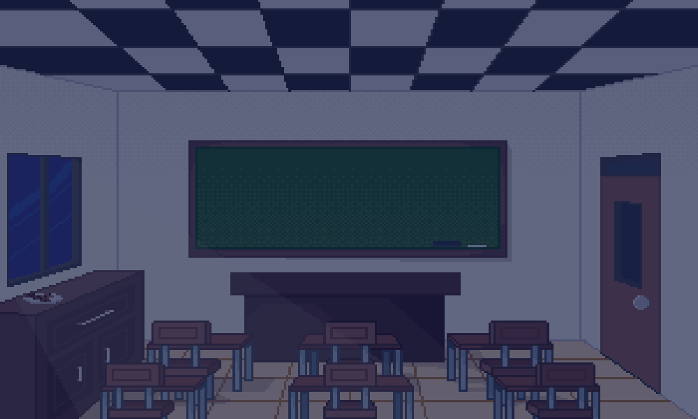
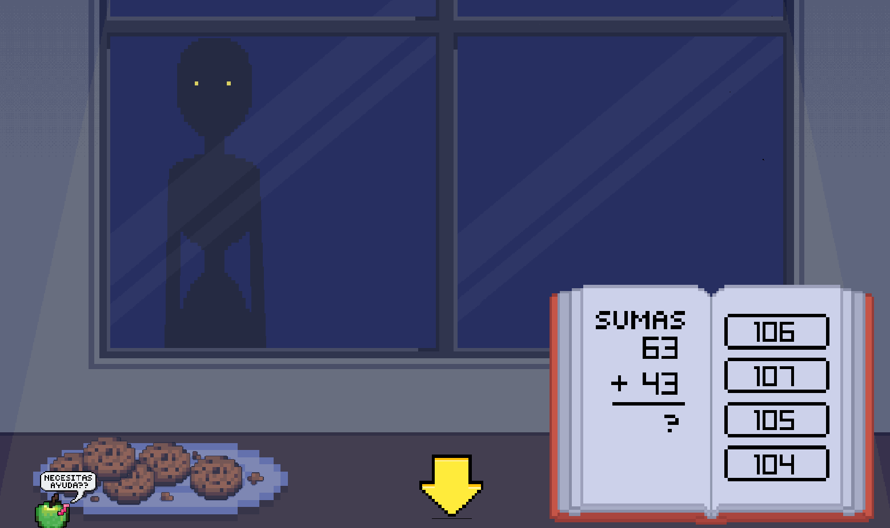
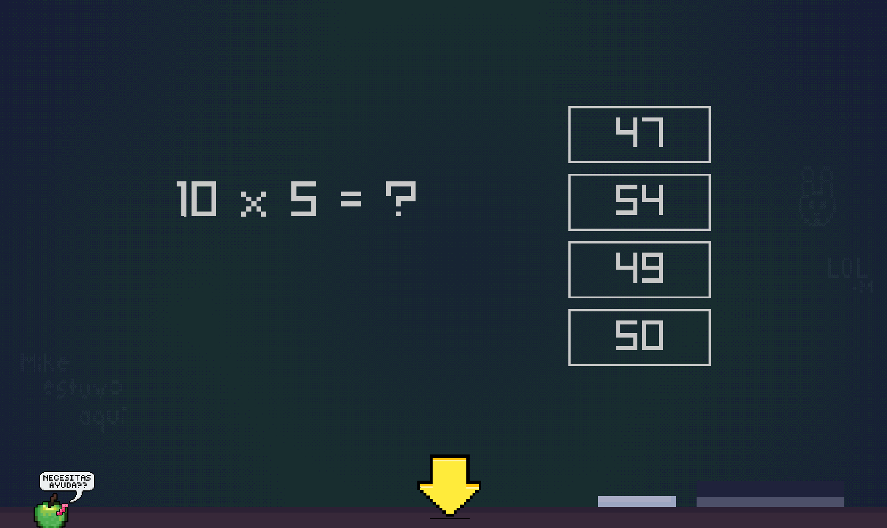
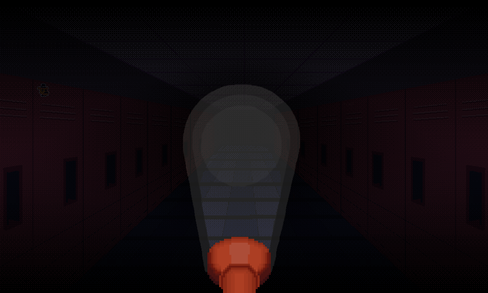
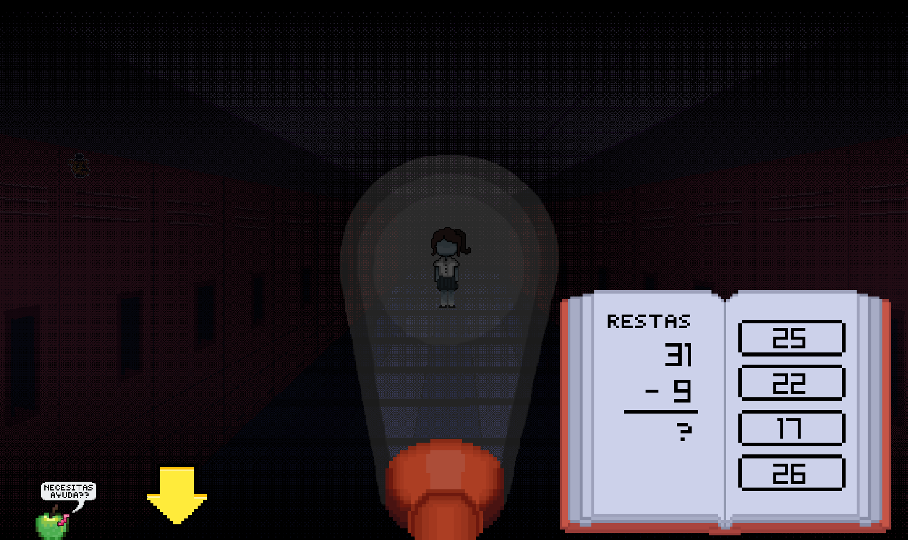

# Five Nights At School

Five Nights At School es un videojuego y proyecto realizado durante el 3er semestre de la carrera ingeniería de Software de la Universidad Autónoma De Baja California de la Facultad de Ingeniería, Arquitectura y Diseño.

Proyecto realizado por:

[Montano Valencia Mike Armando | 379746](https://github.com/MikeArmando)

[Perez Aguirre Mextli Citlali | 379229](https://github.com/mxcitali)

## Objetivo del videojuego:

Resolver operaciones matemáticas básicas de sumas, restas y multiplicaciones, mientras el jugador se divierte participando en el juego. Esto con el propósito de fortalecer las habilidades matemáticas básicas del jugador mientras este juega y al mismo tiempo ser de agrado al usuario a la hora del juego, así manteniendo el interés en este mismo mientras aprende.

## Imagenes del juego

## Edades objetivo:

Para niños de 3ro de primaria (8-9 años)

## Características principales del juego:

- Juego amigable de terror para niños, maneja elementos de terror sin contener material muy “extremo”.
- Creado usando lenguaje C y librería raylib.
- 5 noches consecutivas con dificultad creciente: los números de las operaciones, la frecuencia de aparición de las entidades y la presión de tiempo aumentan en cada noche.
- Sistema de puntajes interno para manejar la cantidad de tareas resueltas y poder concluir el juego.
- Adaptable a problemas matemáticos básicos
- Las tareas están diseñadas para tomar en cuenta las necesidades de aprendizaje del niño, dando suficiente tiempo e intentos para permitir el aprendizaje de forma sencilla.
- Habrá una sección principal al inicio del juego en donde se explicarán los ejercicios a realizar.
- 3 secciones, en donde a cada sección le corresponderá alguna operación matemática, sumas, restas y multiplicaciones.

## Mecánicas Principales

### Reglas (puntuación, como se gana y pierde)

Se usa un sistema de puntuación para determinar si el usuario ganó o perdió:

- Una partida consta de 5 noches consecutivas. Cada noche se supera con la cantidad de respuestas correctas indicada en la tabla, y se pierde al superar los errores permitidos.

| Noche | Respuestas correctas | Errores permitidos | Tiempo límite por ejercicio (ventana / pizarrón / pasillo) |
| ----- | -------------------- | ------------------ | ---------------------------------------------------------- |
| 1     | 10                   | 5                  | Sin límite                                                 |
| 2     | 8                    | 5                  | Sin límite                                                 |
| 3     | 8                    | 4                  | 65 / 65 / 80 s                                             |
| 4     | 8                    | 4                  | 60 / 60 / 75 s                                             |
| 5     | 8                    | 3                  | 55 / 55 / 70 s                                             |

- Desde la noche 3 cada ejercicio tiene un tiempo límite desde que aparece; si se agota, el jugador pierde la partida.
- Si el jugador no responde a ningún ejercicio durante 1 minuto perderá la partida por inactividad.
- Perder en cualquier noche termina la partida. Una nueva partida comienza siempre en la noche 1.

### Mecánicas básicas (movimiento, interacción, etc)

Al inicio el jugador se encuentra en modo seguro, inicia el juego desde la perspectiva frente al pizarrón, habrá explicación de como resolver sumas, restas y multiplicaciones. Después de un tiempo se inicia la partida. Después del modo seguro inicia el juego ya con las entidades, donde el jugador tiene 3 secciones de tareas a cumplir para sobrevivir. Cada noche comienza con una tarjeta con su número. La explicación solo se reproduce en la noche 1, cuyo modo seguro dura 52 segundos; en las noches 2 a 5 el modo seguro dura 8 segundos.

1. La tarea central
   En la pizarra aparecen garabatos, creados por el “fantasma”, estos indicando que hay un ejercicio por resolver, al presionar la flecha frente al pizarrón te lleva a una perspectiva cerca de la pizarra, donde aparece un ejercicio de multiplicación a resolver. El jugador debe hacer las cuentas y seleccionar la opción correcta de las 4 opciones múltiples para sobrevivir.

2. Tarea de la izquierda
   En el salón hay una ventana, en donde periódicamente aparecerá el “monstruo”, se escucha que toca la ventana, existe una flecha de ese lado. Al presionar el botón te cambia la perspectiva a una mesa frente a la ventana donde se encuentra la silueta de la criatura, debes resolver un ejercicio de sumas para calcular cuántas galletas necesita el monstruo y dárselas.

3. Tarea de la derecha
   De un lado del salón hay una puerta que lleva a un pasillo. El jugador debe presionar la flecha hacia la puerta. Al presionar la flecha te cambia la perspectiva al pasillo, deberá prender una linterna para ver si se encuentra la niña en el pasillo, si se encuentra debe de resolver ejercicios de restas para sobrevivir.

4. Indicadores de entidades:
   Durante la partida habrá indicadores de que hay un ejercicio por resolver en cada sección, en el pizarrón aparecerán grabados, en la ventana se verá la mano del “monstruo” y la única manera de saber si se encuentra “La niña” es prendiendo la linterna en el pasillo. Una vez resuelto desaparecerán estos indicadores (dependiendo de la sección solucionada). Desde la noche 3 la mano del “monstruo” solo aparece cuando le quedan 30 segundos de paciencia; el golpe en la ventana se escucha en todas las noches al llegar.

5. Ejercicios:
   Cada ejercicio tiene 4 opciones múltiples, una de ellas siendo la respuesta correcta de la operación mostrada. El usuario tendrá que escoger la respuesta correcta, cuando la haga regresará a la pantalla previa y la entidad desaparecerá.

6. Pantalla de derrota:
   En el caso que el jugador falle todos sus intentos, la pantalla se vuelve completamente oscura y aparece un mensaje diciendo que perdió la partida, ya que las entidades lo alcanzaron, en la pantalla tiene la opción de salir a la pantalla de inicio. La derrota también ocurre por tiempo agotado en un ejercicio (noches 3 a 5) o por inactividad.

7. Pantalla de victoria:
   Al resolver las preguntas requeridas de una noche, el jugador la sobrevive: la pantalla se vuelve completamente negra y aparece un mensaje con el número de la noche superada; al presionar ENTER inicia la siguiente. Al sobrevivir la noche 5 el juego termina, aparece un mensaje diciendo que sobrevivió y se muestra el tiempo total que duró la partida; este tiempo se muestra en la pantalla de inicio como un trofeo.

## Herramientas usadas para la creación del videojuego

- Librería Raylib
- Lenguaje C
- Vscode

## Instalación y Ejecución del Videojuego

Para obtener la versión lista para jugar desde la sección de lanzamientos:
**[ Five Nights At School](https://github.com/MikeArmando/fnas/releases/tag/fnas_v1.0)**
